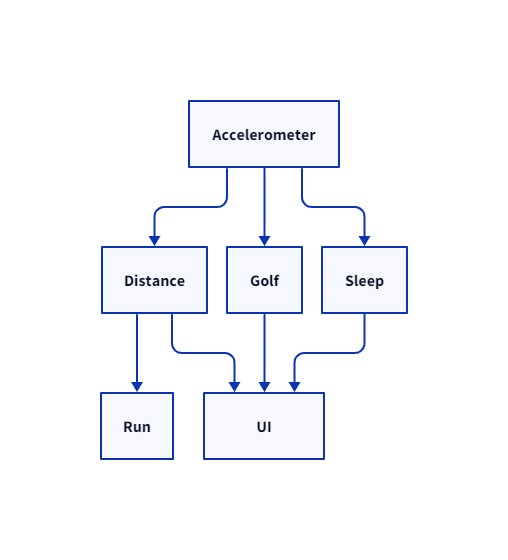
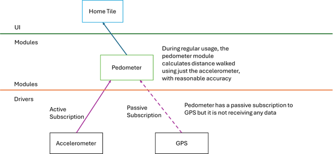
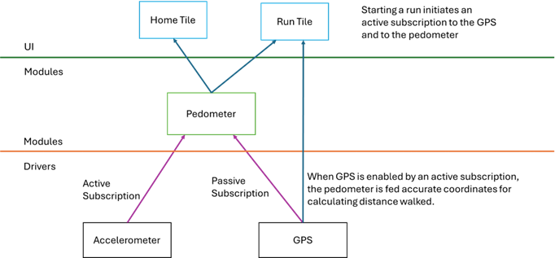

This post is a direct continuation of [/blog/posts/cooperative-multitasking-on-microsoft-band/](/blog/posts/cooperative-multitasking-on-microsoft-band/)

# A State of Burnout

State management is one of the most crucial tasks in software engineering. A large amount of what different software paradigms offer is different ways to manage state.

Coming off of Joule (see [part 1](/blog/posts/history-of-microsoft-joule-band-v0-part-1/) and [part 2](/blog/posts/history-of-microsoft-joule-band-v0-part-2/) for more about Joule), the team had suffered through a nightmare of poor state management. Rather than an overarching design there was a single large “global datastore” that all values were written into. Code would read whatever was in the datastore and hope it was up to date. Needed to turn a sensor on and get some values? Manually turn it on by calling the driver, sleep for a bit, and then read some values. It was not scalable, it killed battery life, and it was an endless source of bugs.

# Typical Embedded Systems

(Note to embedded engineers: I am simplifying by skipping explaining ISRs and IO Buffers and such)

Traditional embedded systems use polling - the CPU reads from an IO line really rapidly, and data is copied into a global variable for other parts of the code to pick up. This is great for latency, poll at 1000hz poll and there is only a 1ms delay.

But polling destroys battery life, 1000hz wakes the CPU every 1ms to read an IO line. It is also prone to data loss - copying a value to a global variable and hoping someone reads it before the value is updated again is not reliable. There is also the problem of knowing if the values are even being consumed, if no one needs the data, you are waking the CPU for no reason!

# Band Can Do Better

Band was set to have a dozen sensors, with multiple modules needing access to the output of each sensor, and higher level code needing access to the processed values from those modules. For example, the accelerometer sends out raw values - the pedometer code computes steps taken, the golf module uses to calculate strokes, the sleep module uses to help determine sleep states - and the UI needs to display all these values with little to no latency. When none of those things are happening, the accelerometer doesn’t need to be on at all\[1\]!

Manually going out and getting values was not going to cut it. Polling was not going to cut it. And because each sensor had multiple consumers, manually turning sensors on and off, was not going to scale. Joule had attempted a global state machine to control what sensors would be used in different “modes”, but Band would have a nearly uncountable number of different possible combinations of components and sensors turned on or off, manually toggling between states was not scalable at all.

## The Initial Proposed Solution

I proposed to the team that subscriptions be the sole method of communication between components. No module would have publicly accessible fields, no getters would exist, every module would maintain a list of fields that could be subscribed to and a list of subscriber callbacks to update with new values.

## Fleshing It Out

### Cascading Subscriptions and Power Management

Subscriptions would cascade -

1. When a run was started, the Run Tile would subscribed to heartrate module.
    
2. The heartrate module would then subscribe to the HRV sensor driver
    
3. The HRV driver would power up the LEDs
    
4. When a run was finished, the Run Tile would unsubscribe from heartrate, and if no other subscribers existed, the heartrate module would unsubscribe from the HRV sensor which would then **turn off the LEDs**.
    

The highest levels of the system are only concerned about what is happening one level below them. The Run Tile only knows it wants heartrate, it shouldn’t have to worry about global state or powering up LEDs.

No active subscriptions caused a module to unsubscribe from all modules it depends on. This meant each module was responsible for only its own power state, be that CPU cycles spend on calculations or powering up/down a sensor.

### Passive Subscriptions

Sometimes a module wanted data from a sensor if the data was available, but it didn’t want to force turning a sensor on.

Passive subscriptions were the solution to this. A passive subscription is an indicator to downstream modules to please pass data if available, but don’t turn on for me. For example, the log file had passive subscriptions to almost everything on Band. When the user went running with GPS the log file’s passive subscription automatically captured and logged GPS coordinates for uploading to the cloud later! (The Run Tile would publish “run started” and “run ended” events to the time series log, this let the cloud know which GPS coordinates in the log file were associated with a run.)

Another example of this is the pedometer/distance module. During every day usage distance walked is calculated using steps taken and stride length. This is reasonably accurate, but not perfect. The distance module had a passive subscription to GPS, so when the user started a run, GPS would automatically be used to calculate distance instead. (It was also used to calibrate the stride length calculations to improve accuracy when GPS was off!)

### Last Known Value

We also added the ability to request that the subscriber be called immediately called back with the last known published value. This was important to get factory test harness times down. Many sensors reported on a fixed interval, and it would take time if a test harness had to wait for that interval to pass before a sensor value was read out. Also it turns out this property is needed in general for correctness of a subscription system!

### Off-Device Subscriptions

Nearly all subscriptions were also also pushed out over USB and Bluetooth. This allowed the test harness, desktops, and phones, to subscribe to Bands. Research scientists loved this! Band quickly became an in demand item for medical research projects all around the country. Real time streaming of skin temperature, GSR, heart rate, UV exposure, and more!

We then took this a step further and came up with an addressing scheme for subscriptions that allowed subscriptions from code running in the cloud. It was possible to live stream your Band to a webpage! The WWE actually collaborated with us to stream real time training metrics from wrestlers in the gym!

The never realized goal is that an ecosystem would pop up of gyms having live leaderboards, or coaches being able to watch clients vitals on phones or a tablet during a training session. (See: Orange Theory)

### Data Injection and Black Boxes

One really cool thing you can do with a pure subscription system is reroute a data source to come in over USB and feed test data into modules!

Because each module in the system only gets data in and out through subscriptions, you can model them as pure functions that take data in and pump data out, although plenty of exceptions existed (e.g. passive subscriptions, sensors that changed their reporting frequency based on aggregate needs of the system).

[^1]: In actuality the accelerometer was always on because steps were always being counted, but we did change the update frequency of the accelerometer based on different needs. Some usages required a really high reporting rate, which does consume more battery.
