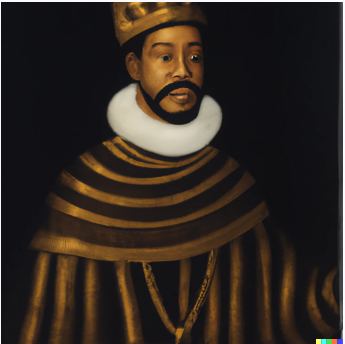
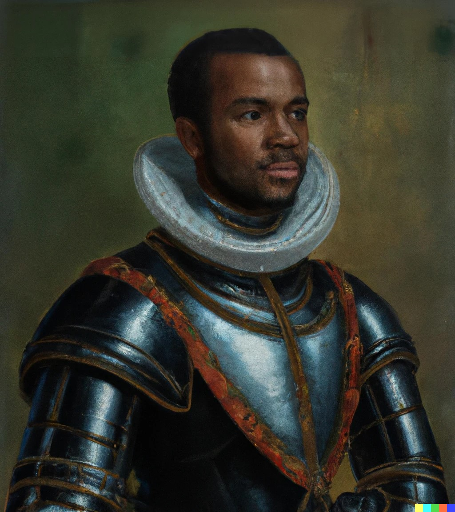

A few months back I released [Arcadia](https://www.generativestorytelling.ai), a demonstration project of how multiple generative technologies can be brought together. While I could write plenty about the project here, the [GitHub repo](https://github.com/devlinb/arcadia) includes a lot of details already and I suggest heading over there if you want to know more about how it works.

What I do want to talk about here is how image generation AIs allowed a 1.5-person team (1 developer, 1 part-time designer) to add more diverse representation to the project.

It's well-known that viewers connect more deeply with characters in media that mirror their own identities. This includes not just cultural components but also visual representation. Think back to the 90s and early 2000s: while many enjoyed watching Arnold Schwarzenegger in action films, American Geeks felt more of a connection with Keanu Reeves in The Matrix. His character's cultural and physical likeness was more relatable.

What I am getting at is this: it is important that people see characters who resemble themselves in media.

This is one of those areas where generative AI can help.

I was ready to launch Arcadia when I recalled a [YouTube video I had watched](https://www.youtube.com/watch?v=uK3NivtVyeE) on the topic of representation in video games, and I decided I could do better than launching with only generic AI-generated pictures of white people! I could launch with generic AI-generated pictures of multiple races!

## The Initial Plan

Arcadia's style is a mixture of early 2000s skeuomorphic web design, cliche medieval stuff, and Renaissance oil paintings. I already had the prompts that generated all my existing Caucasian \[1\] character portraits, so I figured I'd just change the line "Caucasian" to some other ethnic group.

I'd then write a little UI in C# that'd hit up the DALLE 2 endpoints and give me back 6 results, I'd choose one for each role in the story, and I'd be done.

No problem, easy peasy.

## What Actually Happened

Racism. Lots of racism.

I have not tested this recently, but back in July of 2023, when I asked DALLE 2 to generate a "Handsom Caucasian Prince in Medieval Court Garb in the style of a Renaissance oil painting" I got back a fairly nice-looking young man.

If I replaced that with "Beautiful Moorish Prince..." well on occasion I'd get back images that had all the worst racist attributes you can imagine, including large red lips and an overgrown forehead.

Every single image DALLE generated that I wasn't described as "Caucasian" came back mangled in some way. Sometimes horribly, sometimes "just" with distorted facial features. I had to do in-painting on every single image, which involved selecting the face, asking it to generate "the face of a handsome young {Moorish, Asian, Black, Persian} man" replacing whatever disaster DALLE 2 had created the first time around.

Oh DALLE 2 also at that time (and may still today) had a bug where it would cut the top part of heads off, so I had to spend more credits expanding the canvas.

# What About DreamStudio?

Dream Studio, back then at least, was unable to do really good Renaissance oil paintings. I did end up using a few Dream Studio portraits, but stylistically they don't fit in well. Dream Studio did however seem to be a lot less racist.

# Example Image Before Inpainting

I'm not going to try and claim my attempts at inpainting always worked, the black faces in particular still look off for a lot of the final images, but they are worlds better than the hot mess shown above.

After inpainting, I ended up with results like this

## Theories As to Why

My honest guess is a lack of diversity in the training data. There are less paintings of black men and women, and a lot less paintings of black men and women dressed up on their way to a royal court.

The Asian faces generated by DALLE tended to not be so bad, they needed some fixing now and then but they were rarely horribly wrong, and again I'd guess that is a result of training data.

[^1]: I realize Caucasian is not a culture or even a homogenous appearance, people look dramatically different just across Europe. However I am approaching this from my American-centric POV, and Americans are not good at taking note of subtle differences. I wonder what small percentage of Americans realize people in Türkiye are Caucasian...
